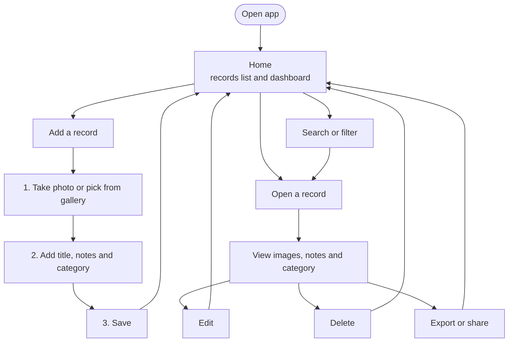
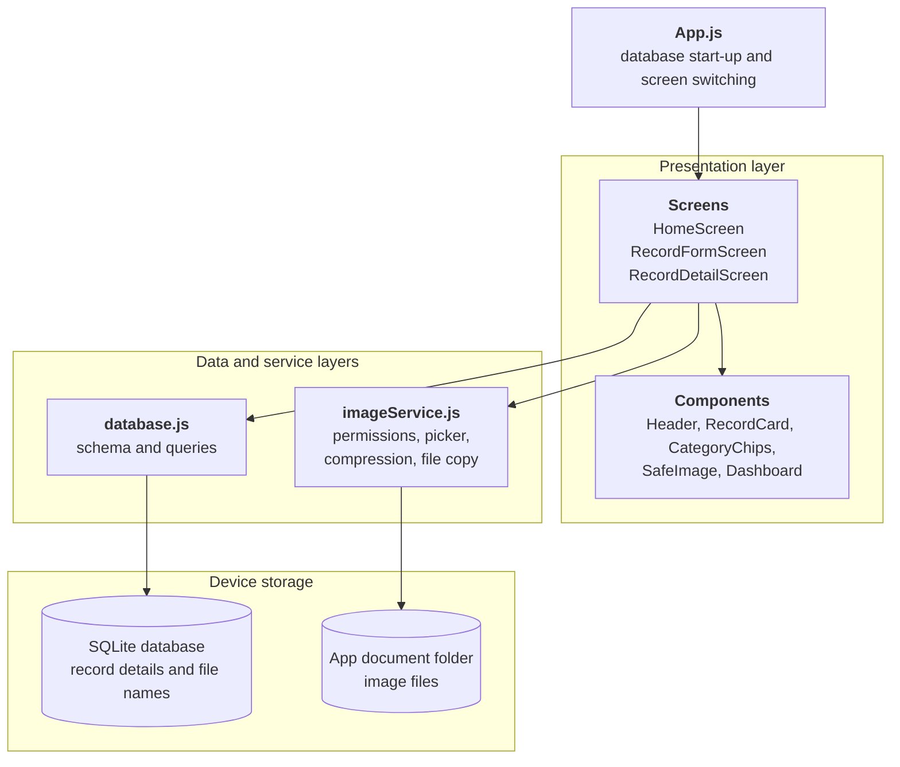
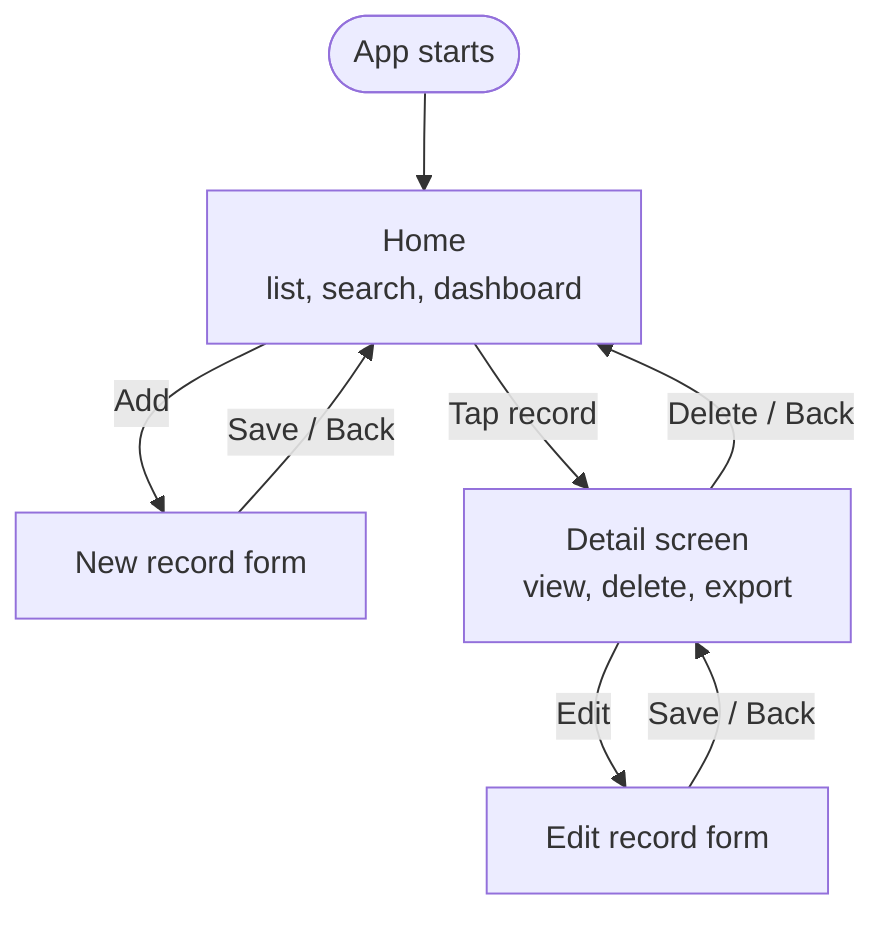
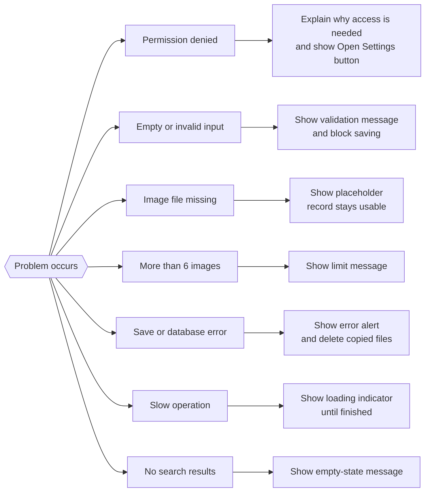

# Smart Capture & Notes: Technical Documentation

**Author:** Dorothy Cindrella  
**Repository:** https://github.com/dorothy-cindrella/smart-capture-notes  
**Date:** 29 October 2026

## Table of Contents

1. [Overview](#1-overview)
2. [Technology Stack](#2-technology-stack)
3. [User Roadmap](#3-user-roadmap)
4. [Features](#4-features)
5. [Application Architecture](#5-application-architecture)
6. [Project Structure](#6-project-structure)
7. [Navigation](#7-navigation)
8. [Storage Approach](#8-storage-approach)
9. [Feature Flow](#9-feature-flow)
10. [Error Handling and Edge Cases](#10-error-handling-and-edge-cases)
11. [UI and Responsiveness](#11-ui-and-responsiveness)
12. [Setup and Run](#12-setup-and-run)
13. [Testing](#13-testing)
14. [Limitations](#14-limitations)
15. [Future Improvements](#15-future-improvements)

---

## 1. Overview

**Smart Capture & Notes** is a mobile application built with React Native and Expo. It lets a user capture a photo with the camera or choose images from the gallery, attach a title, notes and a category, and keep these records organised on the device. Records are stored locally, so they remain available after the app is closed and reopened, with no account or internet connection required.

### Objectives

- Capture or select images and preview them before saving.
- Attach a title, notes and a category to every record.
- Persist records and images on the device.
- List, view, edit, delete, search and filter records.
- Handle permission denials, missing images and invalid input with clear messages.

| Item | Detail |
|---|---|
| Platform | Android and iOS (cross-platform, one code base) |
| Framework | React Native with Expo |
| Storage | SQLite for record data, app document folder for image files |
| Repository | https://github.com/dorothy-cindrella/smart-capture-notes |

---

## 2. Technology Stack

The app uses Expo-managed libraries only, so it runs in Expo Go without native build tools.

| Technology | Purpose |
|---|---|
| React Native + Expo | Cross-platform UI and tooling |
| JavaScript (ES6+) | Application language |
| expo-sqlite | Local relational database for records |
| expo-image-picker | Camera capture and gallery selection |
| expo-image-manipulator | Image resizing and compression |
| expo-file-system | Copying and deleting image files in app storage |
| expo-sharing | Export and share a record |
| react-native-safe-area-context | Keeps content clear of notches and system bars |
| VS Code, Node.js, npm, Git | Development tools and version control |
| Expo Go | Running the app on a physical phone during development |

---

## 3. User Roadmap

The diagram shows how a user moves through the app, from opening it to adding, finding, editing, deleting and exporting records.



*Figure 1: User roadmap*

1. Open the app. The Home screen shows the dashboard and the list of saved records.
2. Tap **Add** to create a record: capture or pick images, then enter a title, notes and a category.
3. Save. The record appears in the list with its thumbnail and title.
4. Use search or the category chips to find records quickly.
5. Tap a record to view it. From there the user can edit, delete or export it.

---

## 4. Features

| Feature | Description | Type |
|---|---|---|
| Camera and gallery | Capture a photo or select an image | Core |
| Image preview | Preview selected images before saving | Core |
| Title, notes, category | Details stored with each record | Core |
| Persistent storage | Data survives closing and reopening the app | Core |
| Record list | Thumbnails and titles in a scrollable list | Core |
| View, edit, delete | Full record management with delete confirmation | Core |
| Search and filter | Text search plus category filter chips | Core |
| Permission handling | Clear message and Open Settings button on denial | Core |
| Missing-image fallback | Placeholder shown if an image file is gone | Core |
| Input validation | Blocks saving invalid or empty input | Core |
| Loading indicators | Shown during database and image operations | Core |
| Multiple images | Up to 6 images per record | Bonus |
| Image compression | Images resized and compressed before saving | Bonus |
| Dashboard | Record counts by category | Bonus |
| Export | Notes as a .txt file plus image sharing | Bonus |
| Video recording | Not implemented (see Limitations) | Not done |

---

## 5. Application Architecture

The code is split into three layers so that each file has one responsibility. Screens never touch the database or the file system directly. They call the data layer and the image service.



*Figure 2: Application architecture*

| Layer | Files | Responsibility |
|---|---|---|
| Entry point | App.js | Initialises the database and switches between screens |
| Presentation | src/screens, src/components | Layout, user input, display of data |
| Service | src/services/imageService.js | Permissions, picker, compression, file copy and delete |
| Data | src/db/database.js | Schema creation and all SQL queries |
| Shared | src/constants.js, src/utils | Categories, limits, colours, formatting helpers |

---

## 6. Project Structure

```
smart-capture-notes/
├── App.js                          Entry point: database start-up, screen switching
├── app.json                        Expo configuration and permission messages
├── package.json                    Dependencies and scripts
├── README.md                       Quick-start guide
├── DOCUMENTATION.md                This document
├── assets/                         App icons and splash images
├── screenshot/                     Screenshots of the working app
├── video/                          Screen recording
└── src/
    ├── constants.js                Categories, limits, colours
    ├── db/
    │   └── database.js             SQLite schema and all queries (data layer)
    ├── services/
    │   └── imageService.js         Permissions, picker, compression, files
    ├── components/
    │   ├── Header.js               Top bar with optional back button
    │   ├── RecordCard.js           List item: thumbnail, title, category
    │   ├── CategoryChips.js        Filter bar and category picker
    │   ├── SafeImage.js            Image with missing-image fallback
    │   └── Dashboard.js            Record counts by category
    ├── screens/
    │   ├── HomeScreen.js           List, search, filter, dashboard
    │   ├── RecordFormScreen.js     Add and edit form
    │   └── RecordDetailScreen.js   View, edit, delete, export
    └── utils/
        └── format.js               Date and file-name helpers
```

---

## 7. Navigation

Navigation is a small state-based switch in `App.js`. The app keeps the current screen name and the selected record in state and renders the matching screen. This avoids an extra navigation library and keeps setup simple for a three-screen app.



*Figure 3: Screen navigation*

| From | Action | To |
|---|---|---|
| Home | Tap Add | New record form |
| Home | Tap a record | Detail screen |
| Detail | Tap Edit | Edit record form |
| Form | Save or back | Home (new) or Detail (edit) |
| Detail | Delete (confirmed) or back | Home |

**Trade-off:** a state switch has no gesture-based back navigation or deep linking. React Navigation would be the next step if more screens were added.

---

## 8. Storage Approach

The app stores **record details in SQLite** and **image files in the app's own document folder**. The database keeps only the image **file name**, never the full path.

### Database schema

Two tables hold the data. One record has many images, linked by `record_id`.

| Table | Column | Type | Purpose |
|---|---|---|---|
| records | id | INTEGER, primary key | Unique record ID |
| records | title | TEXT, required | Record title |
| records | notes | TEXT | Notes entered by the user |
| records | category | TEXT | Category used for filtering and the dashboard |
| records | created_at / updated_at | TEXT | Timestamps |
| record_images | id | INTEGER, primary key | Unique image ID |
| record_images | record_id | INTEGER, foreign key | Owning record |
| record_images | file_name | TEXT | Image file name only, not the full path |

### Why this design

- **Persistence:** images are copied into app storage, so they stay available even if the original photo is deleted from the gallery.
- **Stable references:** the folder path can change between launches or app updates. Saving only the file name and rebuilding the path at runtime prevents broken links.
- **Small database:** large image data stays out of SQLite, which keeps queries fast.
- **Relational model:** one record has many images, which maps to two tables and supports the 6-image limit.
- **Offline first:** everything works without a network connection.

### Cleanup

When a record is deleted, its image rows and image files are removed. If a save fails after images were copied, the copied files are deleted so no orphan files remain.

Column names above reflect the design. Confirm them against `src/db/database.js` before submitting.

---

## 9. Feature Flow

Each main task follows a fixed sequence of steps. Every flow ends back on a screen that shows the updated data.

### Create a record

1. On Home, tap **Add**.
2. Choose the camera or gallery. The app asks for permission if needed.
3. Selected images are compressed and shown as previews (up to 6).
4. Enter a title, notes and a category. Invalid input shows a message and blocks saving.
5. On Save, images are copied into the app folder and the record and file names are written to SQLite.
6. The app returns to Home and the new record appears at the top of the list.

### View and edit

1. Tap a record in the list to open the Detail screen.
2. Tap **Edit**. The form opens pre-filled with the saved data.
3. Change text, add images or remove images, then Save. Removed image files are deleted after the update succeeds.

### Delete

1. Tap **Delete** on the Detail screen.
2. Confirm in the dialog.
3. The database rows and image files are removed and the app returns to Home.

### Search, filter and dashboard

- Typing in the search box filters the list by title and notes.
- Tapping a category chip shows only records in that category.
- The dashboard shows how many records exist in each category and updates after every change.

### Export

1. Tap **Export** on the Detail screen.
2. The app prepares the notes as a .txt file and the record images.
3. The phone's share sheet opens so the user can send or save them.

---

## 10. Error Handling and Edge Cases



*Figure 4: Error handling paths*

| Situation | App behaviour |
|---|---|
| Camera or gallery permission denied | Explains why access is needed and offers an Open Settings button |
| Empty title or invalid input | Validation message; saving is blocked |
| Image file missing from storage | Placeholder is shown; the record can still be opened and edited |
| More than 6 images selected | Limit message; extra images are not added |
| Database or file error while saving | Error alert; copied files are cleaned up |
| Slow operation (loading, saving, compressing) | Loading indicator is shown and hidden afterwards |
| Search or filter returns nothing | Empty-state message |
| User cancels the camera or picker | Returns to the form with no change |

---

## 11. UI and Responsiveness

- **Safe areas:** `react-native-safe-area-context` keeps headers and buttons clear of notches, status bars and gesture bars.
- **Flexible layouts:** screens use Flexbox with relative sizing instead of fixed pixel widths, so they adapt to phones of different sizes.
- **Scrolling:** lists and long forms scroll, so content is never cut off on small screens.
- **Keyboard:** form inputs remain reachable when the keyboard is open.
- **Consistent design:** shared constants for colours, spacing and categories, and reusable components (Header, RecordCard, CategoryChips).
- **Feedback:** loading indicators, confirmation before delete, and readable error messages.

---

## 12. Setup and Run

### Prerequisites

- Node.js LTS (check with `node -v`)
- VS Code
- Git
- Expo Go app on an Android or iOS phone
- Phone and computer on the same Wi-Fi network

### Run the project

```
git clone https://github.com/dorothy-cindrella/smart-capture-notes.git
cd smart-capture-notes
npm install
npx expo start
```

1. Scan the QR code with Expo Go (Android) or the Camera app (iPhone).
2. If the QR code does not connect, stop the server and run `npx expo start --tunnel`.
3. To rebuild from scratch, run `npx create-expo-app@latest smart-capture-notes --template blank`, then install the packages below.

```
npx expo install expo-sqlite expo-image-picker expo-file-system expo-image-manipulator expo-sharing react-native-safe-area-context
```

Use `npx expo install` instead of `npm install` for these packages so the versions match your Expo SDK.

---

## 13. Testing

Testing was done manually using Expo Go. No automated tests are included. Each test case below was run and passed.

| # | Test case | Expected result | Status |
|---|---|---|---|
| 1 | Android bundle build | App bundles without errors | Passed |
| 2 | Capture a photo with the camera | Preview appears; image can be saved | Passed |
| 3 | Pick an image from the gallery | Preview appears; image can be saved | Passed |
| 4 | Add up to 6 images; try a 7th | 6 accepted; limit message for the 7th | Passed |
| 5 | Save with an empty title | Validation message; not saved | Passed |
| 6 | Close and reopen the app | All records and images still present | Passed |
| 7 | Edit a record | Changes are saved and shown | Passed |
| 8 | Delete a record | Confirmation, then removed from list | Passed |
| 9 | Search by title | Only matching records appear | Passed |
| 10 | Filter by category | Only that category appears | Passed |
| 11 | Deny camera permission | Message with Open Settings button | Passed |
| 12 | Remove an image file, reopen the record | Placeholder shown; no crash | Passed |
| 13 | Export a record | Share sheet opens with notes and image | Passed |
| 14 | Dashboard counts | Counts match the records in each category | Passed |
| 15 | Small and large screens | Layout stays usable | Passed |

---

## 14. Limitations

- **Video recording** is not implemented (optional bonus feature).
- **No cloud sync or backup:** data lives only on the device. Uninstalling the app deletes it.
- **Simple navigation:** a state switch without gesture back or deep links.
- **Manual testing only:** there are no automated tests yet.
- **Tested with Expo Go:** a standalone production build has not been created.
- **Image limit:** a maximum of 6 images per record.

---

## 15. Future Improvements

- Video recording and playback linked to a record.
- Cloud backup and sync with Firebase or Supabase.
- React Navigation for gesture back and deep links.
- Tags, sorting options and date-range filters.
- Export a record as a PDF.
- Automated tests with Jest and React Native Testing Library.
- Dark mode and accessibility labels for screen readers.
- Optional passcode or biometric lock for private notes.
